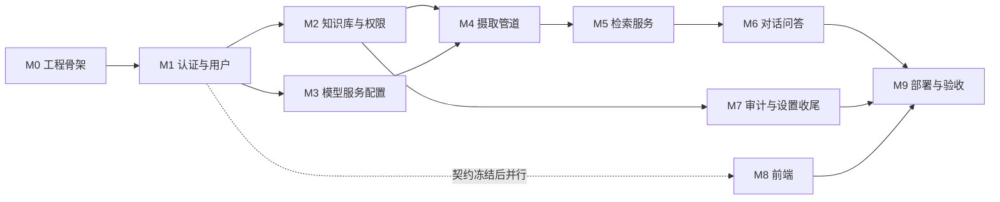

# Woodpecker 开发计划

> 上游文档：[PRD.md](./PRD.md) · [技术选型.md](./技术选型.md) · [数据库设计.md](./数据库设计.md) · [API设计.md](./API设计.md)
> 计划按里程碑组织，给出任务清单、验收标准与依赖关系，不绑定日历时间。

## 1. 里程碑总览

| 里程碑 | 内容 | 对应需求 | 依赖 |
|---|---|---|---|
| M0 | 工程骨架与基础设施 | — | — |
| M1 | 认证、用户管理、审计基座 | FR-01、FR-13（用户部分）、FR-15（写入侧） | M0 |
| M2 | 知识库与成员权限 | FR-02、R6 | M1 |
| M3 | 模型服务配置与 Provider 抽象 | FR-12 | M1 |
| M4 | 摄取管道（Git/上传/URL） | FR-03/04/05/06/11、R1/R1b/R2/R3 | M2、M3 |
| M5 | 混合检索服务 | FR-10、R5 | M4 |
| M6 | 对话问答与反馈 | FR-07/08/09/14 | M5 |
| M7 | 系统设置与审计查询 | FR-13（完整）、FR-15 | M2 |
| M8 | 前端全部页面 | 全部 FR 的 UI | 契约冻结（M2 后可并行） |
| M9 | 部署、验收、运行手册 | 全部 P0 | M1–M8 |

执行模式：单人按 M0→M9 顺序推进；前后端两人时，前端自 M2 结束（契约冻结，swagger 可 mock）起并行。

## 2. 里程碑任务清单

### M0 工程骨架

- [x] 目录结构落地（技术选型 §5）；`cmd/server` 支持 `--mode=api|worker|all`
- [x] `docker-compose.dev.yml`：PG 17（pgvector 镜像）+ Redis
- [x] 配置加载：环境变量 + 默认值（DSN、Redis、加密密钥、端口），内部工具不引配置库
- [x] GORM 连接与连接池；golang-migrate `000001_init` 全部建表迁移（含 `CREATE EXTENSION vector`）
- [x] Gin 路由骨架 `/api/v1` + 统一错误响应/`request_id` 中间件 + slog 日志中间件
- [x] swaggo 注解规范约定；CI：`go vet` / `go test`（web lint+build 随 M8 前端落地）

**验收**：`docker compose up` 后 `/healthz` 返回 ok；迁移重复执行幂等。

### M1 认证、用户与审计基座

- [x] `users` 表 + argon2id 哈希；登录/改密/自助注册开关（settings 键占位）
- [x] JWT 签发（claims：sub/adm/ver）+ `token_version` 校验中间件；密码错误 5 次锁定 10 分钟
- [x] 管理员用户 CRUD：创建（返回一次性初始密码）、禁用/启用、重置密码、`must_change_password` 强制改密
- [x] USER_002/003 保护（不能禁用自己、最后管理员）；首个注册用户自动成为管理员
- [x] 审计写入器（统一 service，覆盖 `user.*`、`auth.*` 动作）

**验收**：AUTH_001~004、USER_001~003 错误码全部可复现；禁用账号下一个请求即 401。

### M2 知识库与成员权限

- [x] `knowledge_bases`/`kb_members` 表；建库/编辑/删除 API（管理员）
- [x] `/kbs` 列表（含 `my_role`）、库详情；成员管理 API（owner/editor/member）
- [x] R6 中间件链：成员资格（非成员 404）→ 编辑者 → 管理者；管理员越权放行并记审计
- [x] FR-13 授权管理与 FR-02 成员管理复用同一 service
- [x] 全局限流中间件（100 req/min/用户，进程内固定窗口；问答 10 req/min 于 M6 挂载）

**验收**：四角色 × 全部操作的权限矩阵表驱动测试全绿；非成员访问库资源返回 404 且不泄露库名。

### M3 模型服务配置

- [x] `model_services`/`model_entries` 表 + 管理 CRUD + 每用途唯一默认（部分唯一索引）
- [x] AES-256-GCM 加密组件（密钥来自 env）；API Key 不回显（仅 `has_key`）
- [x] `Provider` 接口（Chat 流式 / Embed 批量 / Rerank）+ go-openai 实现，按默认条目动态取配置
- [x] 测试连接（对话/向量/重排逐项）；默认配置 Redis 缓存 + 写时失效
- [x] 停用服务不可设默认；删除默认条目拦截 MODEL_002

**验收**：配置 DeepSeek + SiliconFlow 后，跑通一次真实流式对话与 embedding 调用。（真实供应商联调待管理员配置有效 Key 后执行；Provider 已用 mock 服务完成等价验证）

### M4 摄取管道

- [x] `documents`/`document_files`/`ingest_tasks` 表；文档 API 全套（git/upload/url、详情、删除、retry、reindex、sync）
- [x] asynq 队列 + Worker 管道：拉取（go-git / 本地文件 / goquery）→ 格式过滤（R1）+ 敏感排除（R1b，settings 可配）→ 切块（MD 标题 / 代码函数边界 / 递归字符三策略）→ 批量 embedding（batch ≈32）→ 写 chunks
- [x] 状态机 + `stage` 更新；自动重试 ≤3 递增间隔（R3）；删除处理中文档中止任务；重启后僵尸任务置失败
- [x] 限制校验（R2：文件 5MB/50 个、仓库 1GB/5 万文件、库 1000 文档）；凭证 AES 加密落库
- [x] 手动同步：content_hash 文件级增量 diff（未变更跳过、变更重切、删除清分块），同步记审计
- [x] document_files 清单维护（含"已排除"标记）与 go-enry 语言识别

**验收**：接入一个真实仓库 → 状态走完 → 文件清单含排除标记；制造失败 → 重试 → 就绪全链路可演示；同步只处理变更文件。> 管道全链路（单测/集成模拟）已验证；真实仓库 + 有效 embedding Key 的端到端联调与 M3 一并执行。

### M5 检索服务

- [x] 混合检索 SQL（向量 HNSW + trigram，RRF k=60）+ rerank 精排 + Top-5（未配置 rerank/调用失败时降级 RRF 排序）
- [x] `GET /kbs/{kb}/search` API（分页、快照字段）
- [x] 调参记录：向量距离阈值 0.85、trigram 显式阈值 0.05、chunk 大小/重叠——见 [调参笔记.md](./调参笔记.md)

**验收**：对 10 个预设问题（接口用法/报错/定位类）返回正确文件与行号；空结果空态正确。> SQL 空态/融合/库隔离已由真库集成测试验证；10 问验收与 ef_search 调优待真实语料 + embedding Key 后执行（见调参笔记 §4）。

### M6 对话问答

- [x] `conversations`/`messages`/`message_citations`/`feedbacks` 表；会话 CRUD API（含访问规则：先校验库成员资格再校验所属用户）
- [x] SSE 提问端点：多轮上下文组装、检索 Top-5 依据（无命中 → 回答自述"未找到足够依据"且不出 citations）、delta/citations/done/error 事件、15s 心跳
- [x] 断连落库（`interrupted`）；regenerate 替换回答；点踩（原因 1-4、覆盖/撤销）；问答限流 10 req/min
- [x] Prompt 工程：引用编号约束、输出校验（编号须在给定片段范围内，越界重新生成一次）

**验收**：流式回答 + 引用可展开/跳转；依据不足时明确说明且无引用；多轮指代正确；停止生成保留部分回答。> SSE 帧序列/访问规则/中断落库/重试与引用落库已由单测 + 真库集成测试验证；真实模型 Key 下的回答质量与前端展开跳转待 M8/M9 联调。

### M7 系统设置与审计收尾

- [x] `settings` 表 + 排除规则/注册开关管理 API（GET/PATCH /admin/settings，记 setting.update 审计）
- [x] `GET /admin/audit-logs`、`GET /admin/feedbacks`（user/action/object_type/kb_id/reason/from/to 筛选 + 分页，from/to RFC3339 且 to 为排他边界）
- [x] 对照数据库设计 §5 动作枚举逐项补全埋点（含越权尝试）：23 项全部覆盖；
      修正文档动作前缀 doc.* → document.* 与枚举一致

**验收**：审计页可按人/动作/对象/时间过滤；动作枚举与文档一一对应，无遗漏埋点。> 
埋点对照由 grep 扫描全部 Record/Add 调用点核对（auth.login_failed/locked、user.*×5、
member.*×3、kb.*×4、document.*×5、model.*×2、setting.update）；查询链路由
真库集成测试覆盖（联表用户名/JSON detail/时间窗边界）。

### M8 前端（契约冻结后可并行）

- [ ] 脚手架：Vite + React 19 + TS + Tailwind v4 + shadcn/ui + react-router + TanStack Query
- [ ] 登录/首登强制改密 → 知识库列表/详情（文档列表、状态与阶段轮询、成员管理）
- [ ] 接入向导（Git 凭证/上传拖拽/URL）→ 文档详情（文件清单、排除标记、任务历史）
- [ ] 检索页（片段预览/跳转）
- [ ] 聊天窗：SSE 消费、react-markdown + shiki 高亮、citations 抽屉（预览/跳转）、点踩、会话列表/重命名
- [ ] 管理端：用户、模型服务配置（测试连接）、审计、设置
- [ ] 错误态/空态/加载态全覆盖；按错误码映射提示文案

**验收**：对照 swagger 契约全部页面联调通过；PRD §3 P0 清单逐条 UI 走查。

### M9 部署与验收

- [ ] 生产 `docker-compose.yml`：api、worker、PG、Redis、migrate 一次性任务、Nginx（`proxy_buffering off` 支持 SSE）
- [ ] 首管理员初始化引导（首个注册即管理员）
- [ ] 端到端验收清单：按 PRD §3 P0 逐项勾验（含权限矩阵抽样）
- [ ] 运行手册：每日 pg_dump、重建索引流程、更换 embedding 模型的全量重建步骤、加密密钥管理

**验收**：新机器 `docker compose up -d` 后完成注册→建库→接入→问答全流程。

## 3. 技术风险与对策

| 风险 | 影响里程碑 | 对策 |
|---|---|---|
| tree-sitter Go 绑定依赖 cgo，Windows 构建困难 | M4 | CI 提前验证（M0 已落地 tools/cgo-smoke）；不可行则容器内构建，或回退纯 Go 切块（AST 切块降级为 M4.5，不阻塞主链路） |
| testcontainers-go 在 Windows+Docker Desktop 兼容问题（M1 实测） | M1 集成测试 | 改为 TEST_DSN 注入式集成测试：CI 用 service 容器，本地用 docker-compose.dev.yml；不可达自动跳过 |
| LLM 输出引用编号不可靠、幻觉引用 | M6 | Prompt 强约束 + 输出校验（编号必须落在检索片段集合内），校验失败重试一次，仍失败去引用输出 |
| SSE 经反向代理被缓冲 | M6/M9 | Nginx `proxy_buffering off` + 15s 心跳；开发期直连 |
| 大仓库摄取慢 | M4 | 批量 embedding、Worker 并发数可配；R2 限额兜底；超大函数二次切分 |
| 中英混合检索召回不足 | M5 | 上线后用点踩数据（FR-14）量化评估；zhparser 中文分词已列二期预案 |
| 加密密钥丢失 | M3 | 密钥仅存 env 并写入运行手册；丢失后重录模型 API Key 即可，不涉及内容数据 |

## 4. 开发约定

- **分支**：main 保护，`feature/*` 分支 + 自测清单后合并
- **迁移纪律**：迁移脚本只增不改；表结构变更 = 新迁移文件
- **契约**：swagger 为前后端唯一契约，接口变更先改文档（API设计.md）再动代码
- **测试**：每个 FR 至少一条集成测试（`-tags=integration`，PG 由 TEST_DSN 注入：CI 用 service 容器，本地可用 docker-compose.dev.yml；不可达时自动跳过）；R6 权限矩阵用表驱动测试全量覆盖
- **DoD**：编译 + lint + 测试绿、swagger 更新、对应验收标准逐条勾验、`/md` 文档同步
