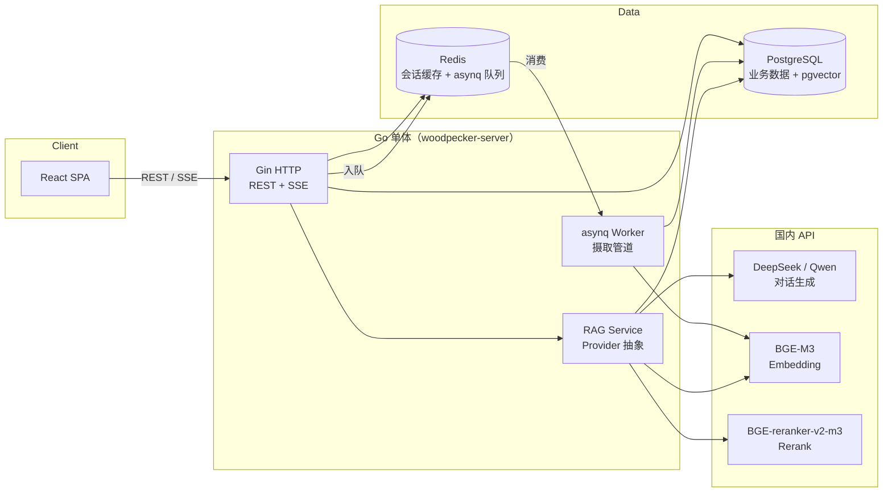
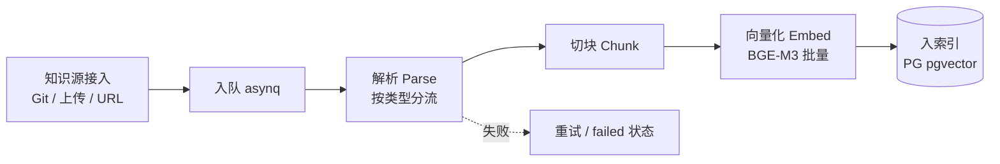

# Woodpecker 技术选型

> AI 驱动的代码/技术文档知识库（RAG，Retrieval-Augmented Generation）。
> 本文记录技术栈决策、对比依据与架构设计，作为后续开发的基线。
> 产品需求见 [PRD.md](./PRD.md)。

## 1. 决策总览

| 领域 | 选型 | 说明 |
|---|---|---|
| 后端语言 | Go 1.27 | 已定 |
| Web 框架 | **Gin** | SSE 流式、中间件生态最全、事实标准 |
| ORM | **GORM** | CRUD 快；向量混合检索等复杂 SQL 手写绕过 |
| 主数据库 | **PostgreSQL 17 + pgvector 0.8+** | 业务数据与向量同库，混合检索一条 SQL 完成 |
| 缓存/队列 | **Redis 7.2+** | 会话缓存 + asynq 异步任务队列，一个组件两个用途 |
| 前端 | **React 19 + Vite + TypeScript + shadcn/ui + Tailwind** | AI 聊天窗生态最成熟，纯 SPA，无 SSR 需求 |
| LLM 接入 | **OpenAI 兼容 API 直连**（go-openai） | 不引入编排框架；供应商/模型/密钥存 PostgreSQL，管理员页面配置，多供应商并存可切换（§2.5） |
| 对话生成（默认推荐） | DeepSeek / Qwen（DashScope） | 作为默认配置写入数据库，随时可替换 |
| Embedding（默认推荐） | BGE-M3（SiliconFlow / DashScope） | 中文/多语强，8k 上下文 |
| Rerank（默认推荐） | BGE-reranker-v2-m3（SiliconFlow） | 提升引用准确率，P0 保留 |
| 知识源解析 | goldmark（MD）+ tree-sitter（代码 AST）+ go-enry（语言识别）+ colly（URL）+ go-git（仓库） | Go 原生，无 sidecar |
| 认证与权限 | golang-jwt + 知识库成员授权（成员表 + 手写中间件，不引 Casbin） | 全局两级（管理员/普通用户）+ 库内管理者/编辑者/成员，矩阵见 PRD R6 |
| 任务队列 | **asynq** | Redis 驱动，复用已有 Redis |
| 迁移 | golang-migrate 或 goose | 标准做法 |
| 日志 | slog（标准库） | Go 1.21+ 原生 |
| 参数校验 | go-playground/validator | 标配 |
| 测试 | testify + testcontainers-go | 集成测试起真实 PG/Redis |
| 实时通信 | **SSE** | 单向流式足够，不上 WebSocket |
| 部署 | Docker Compose（app + PostgreSQL + Redis） | 单机私有化起步 |
| 日志与审计 | slog（运行日志）+ PostgreSQL 审计表（操作日志） | MVP 不引入时序数据库，依据见 §7 |

## 2. 对比与取舍记录

### 2.1 Go Web 框架

前提：问答必须走 SSE 流式输出，优先基于 `net/http` 的框架。

| 框架 | 社区丰富度 | 上手难度 | 性能 | 生态/生产验证 | 结论 |
|---|---|---|---|---|---|
| **Gin** | ★★★★★（~8万★） | 低 | 高（net/http） | 事实标准，中间件最全 | **选定** |
| Echo | ★★★★（~3万★） | 低 | 高 | 成熟稳定 | 备选，风格之争 |
| Chi | ★★★★（~1.9万★） | 低 | 高 | 完全兼容 stdlib | 备选 |
| Fiber | ★★★★（~3.5万★） | 低 | 最高（fasthttp） | 较好 | 否：无 HTTP/2，SSE 兼容性坑 |
| Hertz | ★★★（~6千★） | 中 | 很高 | 字节开源，国内活跃 | 否：对单体应用过重 |
| go-zero / Kratos | ★★★★ | 中高 | - | 微服务全家桶 | 否：单服务应用过重 |

### 2.2 ORM / 数据访问层

| 方案 | 社区丰富度 | 上手难度 | 性能 | 生态 | 结论 |
|---|---|---|---|---|---|
| **GORM** | ★★★★★（~3.8万★） | 低 | 中（反射开销，可接受） | 最全，pgvector-go 可配合 | **选定** |
| ent | ★★★★（~1.5万★） | 中高 | 高 | Meta 出品，类型安全 | 否：pgvector 需自行扩展，接入摩擦大 |
| sqlc | ★★★★（~1.5万★） | 中 | 最高 | SQL-first，编译期类型安全 | 备选思路：检索 SQL 全手写时最舒服 |
| Bun | ★★（~4千★） | 中 | 高 | uptrace 系 | 否：社区偏小 |
| sqlx | ★★★★ | 低 | 高 | 老牌薄封装 | 否：无迁移无关联 |

**约定**：CRUD 用 GORM；混合检索、批量向量写入等性能敏感 SQL 直接手写（`pgvector-go` 提供向量类型映射）。

### 2.3 前端

| 方案 | 社区丰富度 | 上手难度 | AI 场景契合 | 结论 |
|---|---|---|---|---|
| **React 19 + Vite + shadcn/ui** | ★★★★★ | 低中 | 最好：react-markdown、shiki 高亮、mermaid、流式渲染轮子齐全 | **选定** |
| React + Vite + Ant Design | ★★★★★ | 低 | 好 | 备选：观感偏传统管理端 |
| Vue 3 + Naive UI / Element Plus | ★★★★ | 低 | 好 | 备选：团队熟 Vue 则换此方案 |
| Next.js | ★★★★★ | 中 | 好 | 否：后端已是 Go，SSR 价值不大 |
| SvelteKit | ★★★ | 低中 | 一般 | 否：生态小 |

聊天窗关键体验依赖：react-markdown（渲染）、shiki（代码高亮）、mermaid（图表）、流式 SSE 消费。

### 2.4 向量检索

| 方案 | 社区丰富度 | 上手难度 | 性能/规模 | 结论 |
|---|---|---|---|---|
| **pgvector** | ★★★★ | 低 | HNSW 索引，百万~千万级够用 | **选定（MVP）** |
| Qdrant | ★★★★ | 中 | 高，标量过滤强 | 演进方向（触发条件见 §6） |
| Milvus | ★★★★ | 中高 | 大规模最强 | 否：分布式起步运维重 |
| Weaviate | ★★★ | 中 | 高 | 否 |

选定理由：与业务数据同库 → 一条 SQL 完成「向量 + 全文 + 过滤」混合检索（RRF 融合），事务一致性免费获得，零新增运维组件。

### 2.5 LLM / Embedding 接入

| 方案 | 社区丰富度 | 上手难度 | 结论 |
|---|---|---|---|
| **OpenAI 兼容 API 直连** | ★★★★★ | 低 | **选定**：DeepSeek/Qwen/Ollama/vLLM/OpenAI 同一套协议 |
| Eino（CloudWeGo） | ★★★★ | 中 | 否：MVP 管道简单，暂不需要编排框架；二期做 Agent 时再评估 |
| langchaingo | ★★★ | 中 | 否：文档滞后、API 变动频繁 |

**配置化设计（不写死在配置文件）**：

- 供应商与模型存 PostgreSQL，管理员在后台页面维护，不重启服务即生效。
- 数据模型：`模型服务`（名称、协议 = OpenAI 兼容、Base URL、API Key 加密存储、启用状态）+ `模型条目`（所属服务、用途 = 对话/向量/重排、模型名、参数、默认标记）。
- 任何 OpenAI 兼容服务（DeepSeek、DashScope、SiliconFlow、Ollama、vLLM、OpenAI）都通过「Base URL + API Key + 模型名」接入，无需改代码。
- API Key 应用层加密（AES-GCM，密钥来自环境变量），库里不落明文。
- 每个用途绑定一个默认条目；切换默认即全站生效，进行中的请求用旧配置完成。
- 配置保存时提供「测试连接」：分别验证对话、向量、重排的可用性。

### 2.6 异步任务队列

摄取管道 `解析 → 切块 → 向量化 → 入库` 必须异步执行。

| 方案 | 社区丰富度 | 结论 |
|---|---|---|
| **asynq** | ★★★★（~1万★） | **选定**：Redis 驱动，复用已有组件，支持重试/定时/优先级 |
| River | ★★★ | 备选：Postgres 队列，事务一致性好 |
| machinery | ★★★ | 否：设计偏老 |

## 3. 系统架构



单体架构，API 与 Worker 同进程部署（也可拆开跑两个实例共用 Redis 队列）。

## 4. RAG 管道设计

### 4.1 摄取管道（写入侧）



**切块策略**（按文档类型分流）：

| 类型 | 策略 | 说明 |
|---|---|---|
| Markdown | 按标题层级切块，超长段落二次切分 | 保留标题路径作为块上下文 |
| 代码 | tree-sitter 按函数/类边界 AST 切块 | go-enry 识别语言；超大函数内部再切 |
| 通用文本 | 递归字符切块（重叠窗口） | 兜底 |

每个 Chunk 持有的元数据：知识库 ID、文档 ID、语言、代码文件路径 + 行号范围（代码）、标题路径（MD）、字符位置。

### 4.2 检索管道（读取侧）

1. 查询向量化（BGE-M3）
2. **混合检索**：pgvector 余弦相似度（HNSW）+ PostgreSQL 全文/模糊匹配，RRF（Reciprocal Rank Fusion）融合排序
3. Top-N 送 **BGE-reranker-v2-m3** 精排
4. 最终 Top-K 片段 + 来源元数据注入 Prompt → DeepSeek/Qwen 流式生成
5. 引用编号 [1][2]… 与片段一一对应，前端点击跳转源文件/行号

MVP 中文全文检索用 `pg_trgm` 模糊兜底；`zhparser`/`pg_jieba` 中文分词 FTS 二期再上。

## 5. 代码结构建议（Monorepo）

```text
woodpecker/
├── cmd/
│   └── server/          # 入口（API + Worker，可 flag 分离）
├── internal/
│   ├── handler/         # Gin 路由与参数绑定
│   ├── service/         # 业务逻辑
│   ├── repo/            # GORM / 手写 SQL
│   ├── rag/             # 切块、检索、Provider 抽象、Prompt
│   ├── worker/          # asynq 任务（parse/chunk/embed/index）
│   ├── model/           # 数据模型
│   └── middleware/      # JWT、CORS、日志
├── migrations/          # SQL 迁移
├── web/                 # React SPA（Vite）
├── md/                  # 本文档与 PRD
└── docker-compose.yml
```

## 6. 二期演进预留

| 项 | 触发条件 | 方案 |
|---|---|---|
| PDF / Office 解析 | 需要 PDF/Word 入库 | 增加 Python unstructured / docling sidecar 容器，Worker 经消息队列调用 |
| MCP Server | IDE Agent（Cursor / Claude Code）直连查库（PRD P1） | 复用 service 层暴露 MCP 工具：search / fetch_document |
| 更细粒度授权（库内单仓库）或用户组批量授权 | 出现按仓库隔离诉求，或几十人后成员管理疲劳 | 用户组表 + 组-库授权；权限过滤集中在检索 service 一处 |
| Git 仓库定时自动同步 | 内容腐化诉求明确 | asynq 周期任务增量拉取变更（P0 已有手动同步） |
| 中文全文检索 | 混合检索中文召回不足 | zhparser / pg_jieba 扩展 |
| 独立向量库 | 向量 > 千万级、或复杂标量过滤成为瓶颈 | 迁 Qdrant，检索层接口已隔离 |
| Agent 编排 | 多步推理 / 工具调用需求 | 评估 Eino |
| RAG 评测 | 切块/检索策略迭代需要量化 | 评测集 + 召回率/引用准确率指标 |

## 7. 日志与可观测性策略

**结论：MVP 不引入独立时序数据库。** 内部几十人量级，日志量小，为没到的数据量提前引入 ClickHouse/ES 属于过度设计。

| 日志类型 | 方案 | 说明 |
|---|---|---|
| 运行日志 | slog 结构化输出 → stdout，Docker 收集 | 开发与排障看容器日志足够 |
| 操作审计 | PostgreSQL 审计表（权限变更、库/文档删除、模型配置变更、同步等）+ 管理员查看页 | 数据量小、需与业务对象关联查询，放业务库最合适 |
| 指标监控 | P1：Prometheus + Grafana（时序库的角色由它承担） | 有运维诉求再上，MVP 用日志兜底 |

独立时序库的触发条件（满足其一再考虑）：运行日志需要全文检索与长期留存 → Loki；指标/埋点量大 → Prometheus；审计日志百万级且需复杂分析 → TimescaleDB（PG 扩展，运维经验可复用）。

## 8. 可替换性设计边界（防腐层取多少）

原则：**分层但不空转抽象**——哪里有真实的多实现/高替换概率，哪里才做接口。

| 边界 | 做法 | 理由 |
|---|---|---|
| LLM 供应商 | **认真抽象**：`Provider` 接口（Chat/Embed/Rerank） | 真实需求：管理员配置多供应商、随时切换（§2.5） |
| 切块器 | **策略分流**：MD/代码/通用各一个实现，按类型路由 | 天然多实现，切块策略会持续迭代 |
| Web 框架（Gin→Hertz） | **不做接口抽象**，靠分层隔离：`*gin.Context` 只出现在 handler 层，service 用自己的参数/返回结构体 | 给路由器造抽象层是纯负担，且挡不住中间件生态重写；真要换框架，handler 是机械替换，service 干净则工作量可控 |
| ORM（GORM→sqlc） | **不做 Repository 接口 + 假实现**；GORM 与手写 SQL 共存（复杂检索直接写 SQL） | sqlc 与 GORM 可共存而非二选一；"换 ORM"的实际手段是 service 层不出现 GORM 类型，而不是加接口 |
| 存储引擎（PG） | 不抽象 | 换数据库是伪需求；pgvector→Qdrant 的切换隔离在检索 service 一处（§6 已列触发条件） |

判定标准：一个接口若只有一个实现、且没有第二个实现的真实计划，它就是过度设计；若依赖存在真实多实现需求（模型供应商、切块策略），抽象成本远低于收益。handler 薄、service 纯、SQL 集中在 repo/检索层——这三条分层纪律本身就是"以后好换"的全部保障。

## 9. 版本基线

> 以下为开发基线大版本，实施时取该大版本下最新稳定版，锁定于 `go.mod` / `package.json`。

| 组件 | 基线版本 | 备注 |
|---|---|---|
| Go | 1.27 | 已定（go.mod） |
| Gin | v1.10+ |  |
| GORM | v1.25+（v2 系列） | `gorm.io/gorm` |
| pgvector-go | v0.3+ | GORM 向量类型映射 |
| PostgreSQL | 17| 启用 pgvector 0.8+ |
| Redis | 7.2+|  |
| asynq | v0.24+ | 任务队列 |
| golang-jwt | v5 | 认证 |
| validator | v10 | go-playground |
| golang-migrate | v4.18+ | 或 goose |
| goldmark | v1.7+ | MD 解析 |
| tree-sitter Go 绑定 | 最新稳定（go-tree-sitter-bare） | 代码 AST 切块 |
| go-enry | v2 | 语言识别 |
| colly | v2 | URL 抓取 |
| go-git | v5 | 仓库拉取 |
| go-openai | v0.3x | sashabaranov，OpenAI 兼容客户端 |
| testcontainers-go | v0.3x | 集成测试 |
| Node.js | 24 LTS | 前端构建 |
| React / Vite / TS / Tailwind | React 19、Vite 最新稳定、TS 5.x、Tailwind v4 | shadcn/ui 当前版本链 |
| 模型（默认推荐，可配置替换） | deepseek-chat 或 qwen-max（对话）、text-embedding-v4 或 bge-m3（向量）、bge-reranker-v2-m3（重排） | 走管理员配置（§2.5），不锁死 |

## 10. 未决事项

| 事项 | 状态 |
|---|---|
| 默认对话模型（DeepSeek vs Qwen） | 两者均兼容 OpenAI 协议且存库可配，跑通后按效果定默认值 |
| Git 仓库凭证方式（token / SSH） | 开发时定，PRD 层面仅要求"支持私有仓库凭证配置" |
```
