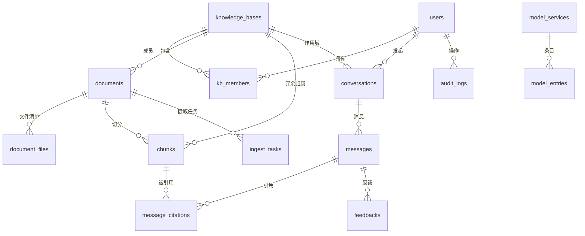

# Woodpecker 数据库设计

> PostgreSQL 17 / pgvector 0.8+。上游文档：[PRD.md](./PRD.md) · [技术选型.md](./技术选型.md)
> 迁移工具：golang-migrate，全部 DDL 走版本化迁移脚本（`migrations/000001_init.up.sql`）。

## 1. ER 总览



## 2. 设计决策

| 决策 | 理由 |
|---|---|
| ID 用 `BIGINT GENERATED ALWAYS AS IDENTITY`，不用 UUID | 内部工具、无需分布式生成；URL 可枚举风险由鉴权覆盖 |
| 删除一律**硬删 + `ON DELETE CASCADE`** | PRD R4：不可恢复，无需软删字段 |
| `chunks` 冗余 `kb_id` | 检索过滤（kb 过滤）不必 join documents；删库级联少一跳 |
| `message_citations` 存**快照字段**（file_path/行号/标题路径/URL） | 文档重建索引后 chunk 会被替换/删除，历史回答的引用不能失效 |
| JWT 无状态 + `users.token_version` | 满足"禁用/改密立即踢出"：版本号入 token claims，中间件比对，不一致即 401；避免会话表 |
| 向量维度固定 `vector(1024)` | BGE-M3 输出 1024 维；Qwen text-embedding-v4 调用时须在模型条目 `params.dimensions`（兼容 `dims`）声明维度，服务端会随请求透传该字段（OpenAI 兼容 `dimensions`）并校验返回维度，不符直接在 Provider 层报错而非让 DB 抛 `expected 1024 dimensions`（审计 P1-14）；**更换 embedding 模型/维度需全量重建索引**（写入运行手册） |
| 全文匹配 MVP 用 `pg_trgm`，不上 tsvector/zhparser | 中文分词二期再上（技术选型 §6）；trgm 已能支撑关键词兜底 |
| 密码 argon2id 哈希；模型 API Key AES-256-GCM 加密落库 | 加密密钥来自环境变量，库中不落明文（PRD FR-12） |
| 文档状态机直接用 `documents.status` 小整数枚举 | 状态少且稳定，见 §5 枚举定义 |

## 3. 表定义

### 3.1 用户与权限

```sql
CREATE TABLE users (
    id                   BIGINT GENERATED ALWAYS AS IDENTITY PRIMARY KEY,
    username             VARCHAR(64)  NOT NULL UNIQUE,
    password_hash        VARCHAR(255) NOT NULL,            -- argon2id
    is_admin             BOOLEAN      NOT NULL DEFAULT FALSE,
    status               SMALLINT     NOT NULL DEFAULT 1,  -- 1=启用 2=禁用
    must_change_password BOOLEAN      NOT NULL DEFAULT FALSE, -- 首登强制改密
    token_version        INT          NOT NULL DEFAULT 0,  -- 禁用/改密 +1 使旧 JWT 失效
    failed_attempts      INT          NOT NULL DEFAULT 0,  -- 连续密码错误计数
    locked_until         TIMESTAMPTZ,                      -- 5 次错误锁定 10 分钟
    created_at           TIMESTAMPTZ  NOT NULL DEFAULT now(),
    updated_at           TIMESTAMPTZ  NOT NULL DEFAULT now()
);

CREATE TABLE knowledge_bases (
    id          BIGINT GENERATED ALWAYS AS IDENTITY PRIMARY KEY,
    name        VARCHAR(50)  NOT NULL,                 -- PRD FR-02：≤50 字符
    description VARCHAR(500),
    created_by  BIGINT       NOT NULL REFERENCES users(id),
    created_at  TIMESTAMPTZ  NOT NULL DEFAULT now(),
    updated_at  TIMESTAMPTZ  NOT NULL DEFAULT now()
);

CREATE TABLE kb_members (
    id         BIGINT GENERATED ALWAYS AS IDENTITY PRIMARY KEY,
    kb_id      BIGINT   NOT NULL REFERENCES knowledge_bases(id) ON DELETE CASCADE,
    user_id    BIGINT   NOT NULL REFERENCES users(id),
    role       SMALLINT NOT NULL,    -- 1=管理者(owner) 2=编辑者(editor) 3=成员(member)，见 PRD R6
    created_at TIMESTAMPTZ NOT NULL DEFAULT now(),
    UNIQUE (kb_id, user_id)
);
CREATE INDEX idx_kb_members_user ON kb_members(user_id);
```

### 3.2 文档与分块

```sql
CREATE TABLE documents (
    id             BIGINT GENERATED ALWAYS AS IDENTITY PRIMARY KEY,
    kb_id          BIGINT   NOT NULL REFERENCES knowledge_bases(id) ON DELETE CASCADE,
    type           SMALLINT NOT NULL,               -- 1=git 2=upload 3=url
    name           VARCHAR(500) NOT NULL,           -- 仓库名 / 文件名 / 页面标题
    status         SMALLINT NOT NULL DEFAULT 1,     -- PRD §4.2 状态机，见 §5
    stage          SMALLINT,                        -- status=2 时：1=解析 2=切块 3=向量化（FR-06 展示用）
    error          TEXT,                            -- 失败原因摘要
    -- git 专属
    repo_url       VARCHAR(1000),
    git_ref        VARCHAR(200),                    -- 分支，默认仓库默认分支
    credential_enc BYTEA,                           -- AES-GCM：{"kind":"token|ssh","secret":...}
    ignore_rules   TEXT[]       DEFAULT '{}',       -- glob 忽略路径
    last_commit    VARCHAR(40),                     -- 最近同步 commit
    last_synced_at TIMESTAMPTZ,
    -- url 专属
    source_url     VARCHAR(2000),
    -- 统计
    file_count     INT,
    total_size     BIGINT,
    created_by     BIGINT   NOT NULL REFERENCES users(id),
    created_at     TIMESTAMPTZ NOT NULL DEFAULT now(),
    updated_at     TIMESTAMPTZ NOT NULL DEFAULT now()
);
CREATE INDEX idx_documents_kb_status ON documents(kb_id, status);

CREATE TABLE document_files (
    id          BIGINT GENERATED ALWAYS AS IDENTITY PRIMARY KEY,
    document_id BIGINT   NOT NULL REFERENCES documents(id) ON DELETE CASCADE,
    path        VARCHAR(1000) NOT NULL,             -- 相对仓库根路径 / 上传文件名
    status      SMALLINT NOT NULL DEFAULT 1,        -- 1=已索引 2=已排除 3=失败
    language    VARCHAR(50),                        -- go-enry 识别
    size        BIGINT,
    error       TEXT,
    updated_at  TIMESTAMPTZ NOT NULL DEFAULT now(),
    UNIQUE (document_id, path)
);
CREATE INDEX idx_document_files_doc_status ON document_files(document_id, status);

CREATE TABLE chunks (
    id          BIGINT GENERATED ALWAYS AS IDENTITY PRIMARY KEY,
    document_id BIGINT   NOT NULL REFERENCES documents(id) ON DELETE CASCADE,
    kb_id       BIGINT   NOT NULL REFERENCES knowledge_bases(id) ON DELETE CASCADE, -- 冗余
    file_id     BIGINT   REFERENCES document_files(id) ON DELETE CASCADE,
    content     TEXT     NOT NULL,
    chunk_index INT      NOT NULL,                  -- 文档内序号
    token_count INT,
    -- 来源快照（检索结果与引用展示用）
    file_path    VARCHAR(1000),
    line_start   INT,
    line_end     INT,                               -- 代码块行号范围
    heading_path TEXT,                              -- md 标题路径，如 "部署 / 配置"
    embedding   vector(1024) NOT NULL,
    created_at  TIMESTAMPTZ NOT NULL DEFAULT now(),
    updated_at  TIMESTAMPTZ NOT NULL DEFAULT now(),
    UNIQUE (document_id, chunk_index)
);
-- 向量检索：余弦相似度 HNSW
CREATE INDEX idx_chunks_hnsw ON chunks
    USING hnsw (embedding vector_cosine_ops) WITH (m = 16, ef_construction = 64);
-- 关键词模糊兜底（trigram）
CREATE INDEX idx_chunks_trgm ON chunks USING gin (content gin_trgm_ops);
CREATE INDEX idx_chunks_kb ON chunks(kb_id);
```

### 3.3 会话与反馈

```sql
CREATE TABLE conversations (
    id         BIGINT GENERATED ALWAYS AS IDENTITY PRIMARY KEY,
    kb_id      BIGINT   NOT NULL REFERENCES knowledge_bases(id) ON DELETE CASCADE,
    user_id    BIGINT   NOT NULL REFERENCES users(id),
    title      VARCHAR(200),                      -- 默认取首条提问摘要，可改
    created_at TIMESTAMPTZ NOT NULL DEFAULT now(),
    updated_at TIMESTAMPTZ NOT NULL DEFAULT now()
);
CREATE INDEX idx_conversations_user ON conversations(user_id, updated_at DESC);

CREATE TABLE messages (
    id              BIGINT GENERATED ALWAYS AS IDENTITY PRIMARY KEY,
    conversation_id BIGINT   NOT NULL REFERENCES conversations(id) ON DELETE CASCADE,
    role            SMALLINT NOT NULL,              -- 1=user 2=assistant
    content         TEXT     NOT NULL,
    interrupted     BOOLEAN  NOT NULL DEFAULT FALSE, -- 停止生成的部分回答（API 设计 §4）
    prompt_tokens     INT,
    completion_tokens INT,
    model_entry_id  BIGINT REFERENCES model_entries(id) ON DELETE SET NULL,  -- 本次回答所用模型（溯源；条目删除后置空，保证旧条目可删）
    created_at      TIMESTAMPTZ NOT NULL DEFAULT now()
);
CREATE INDEX idx_messages_conv ON messages(conversation_id, created_at);

CREATE TABLE message_citations (
    id          BIGINT GENERATED ALWAYS AS IDENTITY PRIMARY KEY,
    message_id  BIGINT   NOT NULL REFERENCES messages(id) ON DELETE CASCADE,
    document_id BIGINT,                            -- 快照，无外键约束以防级联清除历史
    seq         INT      NOT NULL,                 -- 引用编号 [1][2]…
    chunk_id    BIGINT,                            -- 可失效（重建后为空仅剩快照）
    file_path   VARCHAR(1000),
    line_start  INT,
    line_end    INT,
    heading_path TEXT,
    source_url  VARCHAR(2000),
    snippet     TEXT
);
CREATE INDEX idx_citations_message ON message_citations(message_id, seq);

CREATE TABLE feedbacks (
    id         BIGINT GENERATED ALWAYS AS IDENTITY PRIMARY KEY,
    message_id BIGINT   NOT NULL REFERENCES messages(id) ON DELETE CASCADE,
    user_id    BIGINT   NOT NULL REFERENCES users(id),
    reason     SMALLINT NOT NULL,                  -- 1=引用不相关 2=内容错误 3=没有找到想要的 4=其他
    comment    VARCHAR(500),                       -- reason=4 时必填
    created_at TIMESTAMPTZ NOT NULL DEFAULT now(),
    UNIQUE (message_id, user_id)                   -- 重复点踩覆盖
);
```

### 3.4 模型配置（PRD FR-12）

```sql
CREATE TABLE model_services (
    id          BIGINT GENERATED ALWAYS AS IDENTITY PRIMARY KEY,
    name        VARCHAR(100) NOT NULL,
    base_url    VARCHAR(500) NOT NULL,
    api_key_enc BYTEA        NOT NULL,              -- AES-256-GCM 密文
    enabled     BOOLEAN      NOT NULL DEFAULT TRUE,
    created_at  TIMESTAMPTZ  NOT NULL DEFAULT now(),
    updated_at  TIMESTAMPTZ  NOT NULL DEFAULT now()
);

CREATE TABLE model_entries (
    id         BIGINT GENERATED ALWAYS AS IDENTITY PRIMARY KEY,
    service_id BIGINT   NOT NULL REFERENCES model_services(id) ON DELETE CASCADE,
    purpose    SMALLINT NOT NULL,                   -- 1=chat 2=embedding 3=rerank
    model_name VARCHAR(200) NOT NULL,
    params     JSONB     NOT NULL DEFAULT '{}',     -- temperature 等
    is_default BOOLEAN  NOT NULL DEFAULT FALSE,
    created_at TIMESTAMPTZ NOT NULL DEFAULT now(),
    updated_at TIMESTAMPTZ NOT NULL DEFAULT now()
);
-- 每个用途有且仅有一个默认条目（部分唯一索引）
CREATE UNIQUE INDEX uq_model_entries_default ON model_entries(purpose) WHERE is_default;
-- 读取默认配置走 Redis 缓存（key: model_default:{purpose}），写入时失效
```

### 3.5 任务与审计

```sql
CREATE TABLE ingest_tasks (
    id          BIGINT GENERATED ALWAYS AS IDENTITY PRIMARY KEY,
    document_id BIGINT   NOT NULL REFERENCES documents(id) ON DELETE CASCADE,
    type        SMALLINT NOT NULL,                  -- 1=全量摄取 2=增量同步
    status      SMALLINT NOT NULL DEFAULT 1,        -- 1=排队 2=运行 3=成功 4=失败
    retries     INT      NOT NULL DEFAULT 0,        -- 自动重试 ≤3（PRD R3）
    error       TEXT,
    payload     JSONB,                              -- 增量同步的变更文件列表等
    created_at  TIMESTAMPTZ NOT NULL DEFAULT now(),
    started_at  TIMESTAMPTZ,
    finished_at TIMESTAMPTZ
);
CREATE INDEX idx_ingest_tasks_doc ON ingest_tasks(document_id, created_at DESC);

CREATE TABLE audit_logs (
    id          BIGINT GENERATED ALWAYS AS IDENTITY PRIMARY KEY,
    user_id     BIGINT,                             -- 可空=系统动作
    action      VARCHAR(50) NOT NULL,               -- 见 §5 动作枚举
    object_type VARCHAR(30),                        -- user/kb/document/model/setting
    object_id   BIGINT,
    detail      JSONB,                              -- 变更前后摘要
    ip          VARCHAR(45),
    created_at  TIMESTAMPTZ NOT NULL DEFAULT now()
);
CREATE INDEX idx_audit_created ON audit_logs(created_at DESC);
CREATE INDEX idx_audit_user    ON audit_logs(user_id, created_at DESC);
CREATE INDEX idx_audit_object  ON audit_logs(object_type, object_id);
```

### 3.6 系统设置

```sql
CREATE TABLE settings (
    key        VARCHAR(50) PRIMARY KEY,             -- exclusion_rules / self_register_enabled / ...
    value      JSONB NOT NULL,
    updated_at TIMESTAMPTZ NOT NULL DEFAULT now(),
    updated_by BIGINT REFERENCES users(id)
);
-- exclusion_rules: {"patterns":[".env*","*.pem","*.key","id_rsa*","credentials*","*secret*","*.p12","secrets/"]}
```

## 4. 检索 SQL 形态（手写，不走 GORM）

```sql
-- 混合检索：向量 + trigram 模糊，RRF 融合，Top-N 送 rerank
WITH vec AS (
    SELECT id, row_number() OVER (ORDER BY embedding <=> $2) AS rank
    FROM chunks
    WHERE kb_id = $1
    ORDER BY embedding <=> $2
    LIMIT 50
), kw AS (
    SELECT id, row_number() OVER (ORDER BY similarity(content, $3) DESC) AS rank
    FROM chunks
    WHERE kb_id = $1 AND content % $3
    ORDER BY similarity(content, $3) DESC
    LIMIT 50
)
SELECT c.id, c.content, c.file_path, c.line_start, c.line_end, c.heading_path, d.id AS document_id,
       COALESCE(1.0 / (60 + vec.rank), 0) + COALESCE(1.0 / (60 + kw.rank), 0) AS score
FROM chunks c
LEFT JOIN vec ON vec.id = c.id
LEFT JOIN kw  ON kw.id  = c.id
JOIN documents d ON d.id = c.document_id
WHERE vec.id IS NOT NULL OR kw.id IS NOT NULL
ORDER BY score DESC
LIMIT 50;
```

`$2` 为查询向量，`$3` 为查询关键词。RRF 常数 k=60。结果交 rerank 精排后取 Top-5（PRD R5/引用上限）。

## 5. 枚举与动作清单

**documents.status**：1 待处理 → 2 处理中 → 3 已就绪 / 4 失败（重建索引/同步复用 2；禁止 4→2，重试经 ingest_tasks 产生新任务）。**stage**（仅 status=2）：1 解析 / 2 切块 / 3 向量化。

**document_files.status**：1 已索引 / 2 已排除（R1b 命中）/ 3 失败。

**audit_logs.action**（FR-15 记录范围）：`auth.login_failed`、`auth.locked`、`user.create`、`user.disable`、`user.enable`、`user.reset_password`、`user.set_admin`、`user.change_password`、`member.grant`、`member.remove`、`member.role_change`、`kb.create`、`kb.update`、`kb.delete`、`kb.admin_access`（管理员以非成员身份访问库）、`document.create`、`document.delete`、`document.retry`、`document.reindex`、`document.sync`、`model.service_update`、`model.entry_update`、`setting.update`。

## 6. 运维备注

- 连接池：GORM `PrepareStmt=false`；`MaxOpenConns=20`、`MaxIdleConns=5`、`ConnMaxLifetime=30m` 为默认值，可通过 `DB_MAX_OPEN_CONNS`/`DB_MAX_IDLE_CONNS`/`DB_CONN_MAX_LIFETIME_MINUTES` 配置；Worker 与 API 共用同一数据库，连接池各自独立。
- 备份：`pg_dump` 每日 + WAL 归档可选；chunks 表占大头，重建成本 = 重跑摄取管道（可接受，故备份策略可从简）。
- pgvector 需在迁移中先 `CREATE EXTENSION IF NOT EXISTS vector`。
- 时区统一 `TIMESTAMPTZ`，应用层 UTC 存储、展示按本地时区。
